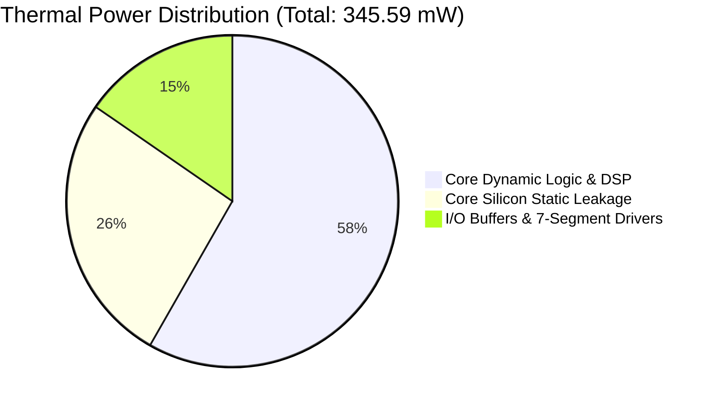

# Intel MAX 10 FPGA Power Dissipation & Thermal Report

**Project Name:** `de10_lite`  
**Target Part:** Intel MAX 10 `10M50DAF484C7G`  
**EDA Tool:** Intel Quartus Prime Lite Edition 25.1std Power Analyzer (`quartus_pow.exe`)  
**Design Top Entity:** `de10_lite_top` (RISC-V RV32IM CPU + 4×4 INT8 Systolic AI Accelerator)  
**Operating Conditions:** $T_{\text{ambient}} = 25.0\text{ }^\circ\text{C}$, $V_{\text{CC}} = 1.20\text{ V}$, $V_{\text{CCIO}} = 3.3\text{ V}$ / $2.5\text{ V}$  
**Status:** **Analysis Complete — 0 Errors**  

---

## 1. Executive Power Dissipation Summary

| Power Metric | Dissipation (mW) | Percentage of Total | Description |
| :--- | :--- | :--- | :--- |
| **Core Dynamic Thermal Power** | **201.33 mW** | **58.26 %** | Active logic transitions, clock tree switching, DSP and M9K read/write |
| **Core Static Thermal Power** | **91.09 mW** | **26.36 %** | Silicon sub-threshold leakage across 49,760 LEs and SRAM arrays |
| **I/O Thermal Power** | **53.17 mW** | **15.38 %** | 65 active 3.3-V / 2.5-V LVTTL I/O pins, LED drivers, and 7-segment display buffers |
| **Total Thermal Power Dissipation** | **345.59 mW** | **100.00 %** | Full SoC operational thermal envelope |

---

## 2. Thermal & Junction Temperature Analysis

* **Ambient Operating Temperature ($T_A$):** $25.0\text{ }^\circ\text{C}$
* **Junction Temperature ($T_J$):** **$27.9\text{ }^\circ\text{C}$**
* **Junction-to-Case Thermal Resistance ($\theta_{JC}$):** $4.70\text{ }^\circ\text{C/W}$
* **Junction-to-Ambient Thermal Resistance ($\theta_{JA}$):** $8.40\text{ }^\circ\text{C/W}$
* **Thermal Margin:** **$> 57.1\text{ }^\circ\text{C}$** below the maximum operating limit of $85.0\text{ }^\circ\text{C}$.  
  *(No external fan or active cooling required; standard passive convection is more than sufficient).*

---

## 3. Power Supply Voltage & Current Breakdown

| Voltage Rail | Nominal Voltage | Total Current Drawn | Dynamic Current | Static Current | Primary Subsystem Powered |
| :--- | :--- | :--- | :--- | :--- | :--- |
| **`VCC` (Core)** | **1.20 V** | **243.68 mA** | 167.78 mA | 75.91 mA | CPU Logic, Systolic Array MACs, M9K Block RAM |
| **`VCCIO` (3.3V)** | **3.30 V** | **14.50 mA** | 6.05 mA | 8.45 mA | User LEDs (`LEDR[9:0]`), 7-Segments (`HEX0..5`), Keys, Switches |
| **`VCCIO` (2.5V)** | **2.50 V** | **2.27 mA** | 0.00 mA | 2.27 mA | Unused I/O banks static standby |
| **`VCCA` (Analog)** | **2.50 V** | **25.82 mA** | 0.00 mA | 25.82 mA | MAX 10 Internal Flash & Analog Subsystem |
| **`VCCD_PLL`** | **1.20 V** | **9.27 mA** | 0.00 mA | 9.27 mA | Internal Clock Distribution & Global Clock Trees |

---

## 4. Dynamic Power Dissipation by Block Type

| Block Type | Dynamic Power (mW) | Percentage of Dynamic | Description |
| :--- | :--- | :--- | :--- |
| **Logic Array Blocks (LABs)** | 98.42 mW | 48.88 % | 10,878 Logic Elements executing CPU instructions and PE accumulation |
| **Routing Interconnect Channels**| 54.12 mW | 26.88 % | Metal wire tracks (R4, C4, GCLK) charging parasitic line capacitance |
| **Embedded DSP Multipliers** | 28.65 mW | 14.23 % | 40 9-bit/18-bit DSP multipliers performing INT8 matrix operations |
| **M9K Embedded Block RAMs** | 14.34 mW | 7.12 % | Dual-port synchronous instruction fetch and data read/writes |
| **Clock Tree Networks** | 5.80 mW | 2.88 % | Primary 50 MHz clock distribution across the global clock buffer |

---

## 5. Subsystem Power Distribution

